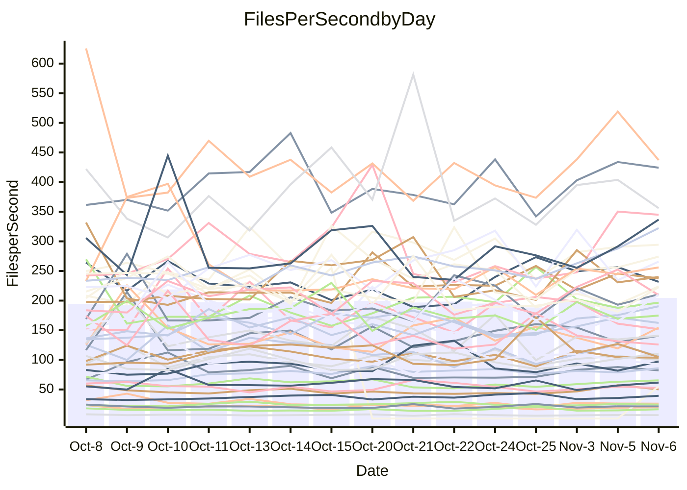

<!---
# This file is auto-generated. Do not edit.
# cspell:disable
--->
# Performance Report

Daily Performance

Time to Process Files

| Repository                                      | Elapsed | Min/Avg/Max          |    SD | SD Graph                |
| ----------------------------------------------- | ------: | :------------------: | ----: | ----------------------- |
| AdaDoom3/AdaDoom3                    |    3.00 | 1.8 /   2.8 /   3.5  |  0.45 | `    ┣━━┻━━╋●━┻━━┫    ` |
| alexiosc/megistos                    |    7.71 | 3.9 /   6.5 /   9.3  |  1.38 | `    ┣━━┻━━╋━━●━━┫    ` |
| apollographql/apollo-server          |    2.63 | 1.4 /   2.4 /   3.3  |  0.42 | `    ┣━━┻━━╋●━┻━━┫    ` |
| aspnetboilerplate/aspnetboilerplate  |    5.69 | 5.1 /   8.0 /  10.2  |  1.60 | `    ┣━●┻━━╋━━┻━━┫    ` |
| aws-amplify/docs                     |   14.31 | 7.4 /  12.7 /  15.4  |  2.31 | `   ┣━━━┻━━╋━●┻━━━┫   ` |
| Azure/azure-rest-api-specs           |    6.69 | 6.2 /  10.0 /  12.2  |  1.70 | `    ●━━┻━━╋━━┻━━┫    ` |
| bitjson/typescript-starter           |    1.11 | 0.7 /   1.0 /   1.3  |  0.17 | `     ┣━┻━━╋●━┻━┫     ` |
| caddyserver/caddy                    |    4.41 | 2.3 /   3.9 /   4.8  |  0.69 | `    ┣━━┻━━╋━●┻━━┫    ` |
| canada-ca/open-source-logiciel-libre |    1.14 | 0.7 /   1.0 /   1.4  |  0.18 | `     ┣━┻━━╋●━┻━┫     ` |
| chef/chef                            |    3.19 | 0.0 /   1.9 /   5.5  |  2.37 | `    ┣━━┻━━╋━●┻━━┫    ` |
| dart-lang/sdk                        |   47.76 | 35.8 /  57.2 /  76.1 |  8.97 | `  ┣━━━●━━━╋━━━┻━━━┫  ` |
| django/django                        |   14.99 | 7.6 /  13.0 /  15.6  |  2.47 | `   ┣━━━┻━━╋━━●━━━┫   ` |
| eslint/eslint                        |   10.40 | 5.8 /   9.4 /  11.5  |  1.64 | `    ┣━━┻━━╋━●┻━━┫    ` |
| exonum/exonum                        |    2.76 | 2.0 /   3.1 /   3.9  |  0.54 | `    ┣━━┻●━╋━━┻━━┫    ` |
| flutter/samples                      |    7.72 | 6.7 /  10.6 /  13.0  |  1.88 | `    ┣●━┻━━╋━━┻━━┫    ` |
| gitbucket/gitbucket                  |    2.69 | 1.9 /   3.2 /   4.5  |  0.58 | `    ┣━━┻●━╋━━┻━━┫    ` |
| googleapis/google-cloud-cpp          |   78.43 | 72.6 / 119.7 / 144.0 | 19.68 | ` ●┣━━━┻━━━╋━━━┻━━━┫  ` |
| graphql/express-graphql              |    0.98 | 0.7 /   1.1 /   1.4  |  0.19 | `     ┣━┻━●╋━━┻━┫     ` |
| graphql/graphql-js                   |    4.01 | 2.1 /   3.3 /   4.4  |  0.68 | `    ┣━━┻━━╋━━●━━┫    ` |
| graphql/graphql-relay-js             |    0.73 | 0.7 /   1.1 /   1.4  |  0.18 | `     ●━┻━━╋━━┻━┫     ` |
| graphql/graphql-spec                 |    1.50 | 0.8 /   1.2 /   1.6  |  0.21 | `     ┣━┻━━╋━━●━┫     ` |
| iluwatar/java-design-patterns        |   10.01 | 7.4 /  11.7 /  14.6  |  2.15 | `    ┣━━●━━╋━━┻━━┫    ` |
| ktaranov/sqlserver-kit               |    5.12 | 3.3 /   5.3 /   6.8  |  1.13 | `    ┣━━┻━━●━━┻━━┫    ` |
| liriliri/licia                       |    3.92 | 2.3 /   3.6 /   4.7  |  0.68 | `    ┣━━┻━━╋●━┻━━┫    ` |
| MartinThoma/LaTeX-examples           |    5.49 | 3.8 /   6.1 /   7.5  |  1.05 | `    ┣━━┻●━╋━━┻━━┫    ` |
| mdx-js/mdx                           |    1.93 | 1.2 /   1.7 /   2.1  |  0.27 | `     ┣━┻━━╋━●┻━┫     ` |
| microsoft/TypeScript-Website         |    4.32 | 3.1 /   4.9 /   6.3  |  0.81 | `    ┣━━┻●━╋━━┻━━┫    ` |
| MicrosoftDocs/PowerShell-Docs        |   25.16 | 14.4 /  23.4 /  28.1 |  3.43 | `   ┣━━━┻━━╋━●┻━━━┫   ` |
| neovim/nvim-lspconfig                |    5.83 | 3.1 /   5.2 /   6.8  |  1.02 | `    ┣━━┻━━╋━●┻━━┫    ` |
| pagekit/pagekit                      |    2.05 | 2.1 /   3.3 /   4.1  |  0.57 | `    ●━━┻━━╋━━┻━━┫    ` |
| php/php-src                          |   27.43 | 13.6 /  22.2 /  28.0 |  4.21 | `   ┣━━━┻━━╋━━┻●━━┫   ` |
| plasticrake/tplink-smarthome-api     |    1.09 | 0.8 /   1.2 /   1.6  |  0.22 | `     ┣━┻━●╋━━┻━┫     ` |
| prettier/prettier                    |    6.44 | 4.5 /   7.6 /   9.3  |  1.31 | `    ┣━━●━━╋━━┻━━┫    ` |
| pycontribs/jira                      |    1.32 | 0.9 /   1.4 /   1.9  |  0.23 | `     ┣━┻━●╋━━┻━┫     ` |
| RustPython/RustPython                |    9.81 | 6.5 /  10.6 /  13.3  |  2.08 | `    ┣━━┻━●╋━━┻━━┫    ` |
| shoelace-style/shoelace              |    1.97 | 1.7 /   2.6 /   3.2  |  0.45 | `    ┣━●┻━━╋━━┻━━┫    ` |
| slint-ui/slint                       |   22.72 | 11.7 /  18.7 /  23.4 |  3.57 | `   ┣━━━┻━━╋━━┻●━━┫   ` |
| SoftwareBrothers/admin-bro           |    1.52 | 1.5 /   2.4 /   3.2  |  0.38 | `    ●━━┻━━╋━━┻━━┫    ` |
| sveltejs/svelte                      |   24.04 | 13.2 /  21.7 /  27.1 |  4.01 | `   ┣━━━┻━━╋━●┻━━━┫   ` |
| TheAlgorithms/Python                 |    4.22 | 3.9 /   6.1 /   7.6  |  1.06 | `    ┣●━┻━━╋━━┻━━┫    ` |
| twbs/bootstrap                       |    2.08 | 1.1 /   1.9 /   2.3  |  0.30 | `     ┣━┻━━╋━●┻━┫     ` |
| typescript-cheatsheets/react         |    1.35 | 0.8 /   1.2 /   1.4  |  0.17 | `     ┣━┻━━╋━━●━┫     ` |
| typescript-eslint/typescript-eslint  |    4.40 | 2.5 /   4.1 /   4.8  |  0.70 | `    ┣━━┻━━╋●━┻━━┫    ` |
| vitest-dev/vitest                    |   11.77 | 6.4 /  10.5 /  13.1  |  2.05 | `    ┣━━┻━━╋━●┻━━┫    ` |
| w3c/aria-practices                   |    2.95 | 2.0 /   3.0 /   4.2  |  0.58 | `    ┣━━┻━━●━━┻━━┫    ` |
| w3c/specberus                        |    1.93 | 1.2 /   1.7 /   2.3  |  0.33 | `     ┣━┻━━╋━●┻━┫     ` |
| webdeveric/webpack-assets-manifest   |    1.26 | 0.8 /   1.2 /   1.4  |  0.16 | `     ┣━┻━━╋●━┻━┫     ` |
| webpack/webpack                      |    5.59 | 5.3 /   8.3 /  10.4  |  1.55 | `    ┣●━┻━━╋━━┻━━┫    ` |
| wireapp/wire-desktop                 |    0.96 | 0.9 /   1.4 /   1.7  |  0.24 | `     ●━┻━━╋━━┻━┫     ` |
| wireapp/wire-webapp                  |   16.87 | 8.8 /  13.6 /  18.3  |  2.78 | `   ┣━━━┻━━╋━━┻●━━┫   ` |

Note:
- Elapsed time is in seconds.

Files per Second over Time

| Repository                                      | Files |   Sec |    Fps |     Rel | Trend Fps              |    N |
| ----------------------------------------------- | ----: | ----: | -----: | ------: | ---------------------- | ---: |
| AdaDoom3/AdaDoom3                    |   103 |  3.00 |  34.33 |  -8.05% | `▁▂▅▂▂▂▂▆▂▄█▂▂█▂▄▂▃▅▃` |   47 |
| alexiosc/megistos                    |   583 |  7.71 |  75.61 | -19.58% | `▂▃▂█▂▃▂▂▅▇▂▅▇▅▆▂▁▃▃▂` |   47 |
| apollographql/apollo-server          |   256 |  2.63 |  97.26 | -10.46% | `▅▆▃▃▃▅▂▄▃▃▅▄▃▁▃▂▂▃█▃` |   47 |
| aspnetboilerplate/aspnetboilerplate  |  2308 |  5.69 | 405.27 |  34.37% | `▂▂▂▂▅▇▅▂██▆▇▃▅█▂▂▅▅▇` |   47 |
| aws-amplify/docs                     |  3039 | 14.31 | 212.30 | -15.04% | `▇▂▂▁▂▅▄▂▁▃▂▅▂▂▄█▂▃▂▂` |   47 |
| Azure/azure-rest-api-specs           |  2607 |  6.69 | 389.96 |  44.70% | `▄▂▄▂▄▅▁▄▄▂█▂▇▇▂█▆▂▂▇` |   47 |
| bitjson/typescript-starter           |    20 |  1.11 |  18.02 | -11.54% | `▂▃▃▃▂█▃▃▃▂▃▅▅▁▄▇▃▂█▃` |   47 |
| caddyserver/caddy                    |   402 |  4.41 |  91.17 | -11.67% | `▂▂▂▆▂▂▅▂▇▂▂▅▄█▂▁▂▂▁▂` |   47 |
| canada-ca/open-source-logiciel-libre |     7 |  1.14 |   6.16 | -10.77% | `▁▃▃█▅▂▇▅▂▄▃▂▅▇▅▅▂▂▅▃` |   47 |
| chef/chef                            |  1040 |  3.19 | 326.23 | 279.37% | `▁▁▁▁▁▁▁▁▁▁▁▁▁▁▁▁▁▁▇█` |   46 |
| dart-lang/sdk                        | 11839 | 47.76 | 247.88 |  16.85% | `▅▃▃▂▃▂▂▃▁▂█▅▃▄▂▃▃▃▅▅` |   47 |
| django/django                        |  2941 | 14.99 | 196.23 | -17.11% | `▇▂▂█▁▆▁▃▁▃▂▃▂▂▁▆▇▄▁▁` |   47 |
| eslint/eslint                        |  2087 | 10.40 | 200.60 | -13.00% | `▁▅▂▂▂▇▄▂▅███▂▂▂▂▁▂▂▂` |   47 |
| exonum/exonum                        |   421 |  2.76 | 152.58 |   9.53% | `▂▅█▅▂▁▂▅▅▂▄▂▂▂█▂▆▃▇▅` |   47 |
| flutter/samples                      |  1703 |  7.72 | 220.66 |  32.00% | `▂▆▃▃▄▆▂▅▂▅▅▁▄▂▆▃█▂▇▆` |   47 |
| gitbucket/gitbucket                  |   427 |  2.69 | 158.79 |  12.92% | `▅▄▃▃▂▃▃▃▃█▂▅▂▅██▅▁▅▅` |   47 |
| googleapis/google-cloud-cpp          | 22116 | 78.43 | 281.98 |  47.55% | `▃▄▂▂▂▂▂▂▁▄▂▂▂▁▁▅▇▂█▇` |   47 |
| graphql/express-graphql              |    26 |  0.98 |  26.42 |   5.80% | `▂▂▂▆▁█▂▂▆▂▂▃▁▃▂█▂▄▄▄` |   47 |
| graphql/graphql-js                   |   556 |  4.01 | 138.56 | -20.88% | `▂▄▆█▇▂▁▂▂▂▂▅▂▂▂▂▂▂▄▂` |   47 |
| graphql/graphql-relay-js             |    28 |  0.73 |  38.16 |  43.85% | `▇▅▂▃▂▃▆▃▄▆▃▃▃▄▃▃▂▂▃█` |   47 |
| graphql/graphql-spec                 |    19 |  1.50 |  12.69 | -19.18% | `▆▂▁▂▂▂▆▂▂█▃▃▅▄▃▆▂▂█▂` |   47 |
| iluwatar/java-design-patterns        |  2239 | 10.01 | 223.67 |  12.58% | `▅▂█▃▄▂▂▅▃█▂▄▁▅▄▄▂▆▂▅` |   47 |
| ktaranov/sqlserver-kit               |   490 |  5.12 |  95.79 |  -2.32% | `▂▆▂█▂▂▁▇▆▄▇▂▂▄▂▂▅▁▂▃` |   47 |
| liriliri/licia                       |  1442 |  3.92 | 367.86 | -11.50% | `▄▅▂▂▇█▂▂▁▄▂▂▂▂▇▇▂█▂▃` |   47 |
| MartinThoma/LaTeX-examples           |  1414 |  5.49 | 257.70 |   6.44% | `▂▂▃▇▆▄▂▆▂▂▇▂▂█▂█▅▅▅▄` |   47 |
| mdx-js/mdx                           |   139 |  1.93 |  71.96 | -11.89% | `▅▂▅▄▆▅█▂▂▄▇▃▄▂▆▄▆▂▂▂` |   47 |
| microsoft/TypeScript-Website         |   765 |  4.32 | 177.13 |   9.92% | `▂▂█▂▅▄█▂▃█▅▃▃▅▃▂▂▃▅▅` |   47 |
| MicrosoftDocs/PowerShell-Docs        |  3127 | 25.16 | 124.27 |  -9.64% | `▂█▂▃▄▃▂▁▄▂▅▃▂▂▃▃▃▁▂▂` |   47 |
| neovim/nvim-lspconfig                |   889 |  5.83 | 152.44 | -13.89% | `▂▁▂▂▂▂▄▂▅▇▄▁▂▇▂▂█▆▄▂` |   47 |
| pagekit/pagekit                      |   741 |  2.05 | 361.26 |  56.95% | `▂▂▅▆▄▂▂▅▇▂▂▂▂▄▂▂▄▁▅█` |   47 |
| php/php-src                          |  2403 | 27.43 |  87.61 | -22.15% | `▅▇▂▁▇▂▅█▅▂▂▂▅▂▂▇▂▇▂▂` |   47 |
| plasticrake/tplink-smarthome-api     |    62 |  1.09 |  56.75 |   5.82% | `▄▅▂▂▃▁▆▁██▆▂▂▂▂▂▃▇▂▅` |   47 |
| prettier/prettier                    |  2791 |  6.44 | 433.14 |  14.40% | `▂█▂▁▂▃▄▆▂▂▄▂▂▂▄▁▁▂▃▄` |   47 |
| pycontribs/jira                      |    80 |  1.32 |  60.57 |   3.85% | `▁▃▃▃▅▂▅▄▂█▃▇▃▅▄▃█▅▂▅` |   47 |
| RustPython/RustPython                |  1069 |  9.81 | 109.01 |   7.14% | `▃▃▂▁▂▇▅▁▁▁▇▂█▇▁▄█▁▄▄` |   47 |
| shoelace-style/shoelace              |   440 |  1.97 | 223.82 |  27.18% | `▂▇█▂▂▁▅▂▇▂▃▅▄▂▂▅▆▂▂▇` |   47 |
| slint-ui/slint                       |  5027 | 22.72 | 221.27 | -16.63% | `▄▇▄█▂▂▂▂▄▂▂▄▇▃▂█▂▂█▂` |   47 |
| SoftwareBrothers/admin-bro           |   441 |  1.52 | 290.81 |  52.07% | `▃▇▆▃▃▂▂▂▅▄▃█▁▃▃▅▂▃██` |   47 |
| sveltejs/svelte                      |  9223 | 24.04 | 383.64 | -13.10% | `▁▂▅▄▄█▂▂▇▂▂▄▂▆▂█▂▂▂▂` |   47 |
| TheAlgorithms/Python                 |  1640 |  4.22 | 388.58 |  39.86% | `▂█▂▂▂▆▆▃▂▂▄▄▄▂▃▁▂▅█▇` |   47 |
| twbs/bootstrap                       |   152 |  2.08 |  73.04 |  -9.41% | `▄▂▆▂▅▂▃▂▂▂▄▅▄▄▄█▃▃▄▂` |   47 |
| typescript-cheatsheets/react         |    24 |  1.35 |  17.76 | -15.85% | `▃▂▄▃▂█▃▂▆▃▇▂▅▃▅▃▅█▃▂` |   47 |
| typescript-eslint/typescript-eslint  |   887 |  4.40 | 201.69 | -10.88% | `▂▂▃▄▂▂▃▂▁▂█▄▃▃▃▂▃▁▅▂` |   47 |
| vitest-dev/vitest                    |  2948 | 11.77 | 250.47 | -13.67% | `▄▂▂▁▂▆▂▂▄█▄▂█▂█▂█▂█▂` |   47 |
| w3c/aria-practices                   |   417 |  2.95 | 141.47 |  -0.87% | `▂▃█▃▂▂▇▅▃▄▃▂▄▆▃▇▅▂▅▄` |   47 |
| w3c/specberus                        |   190 |  1.93 |  98.37 | -15.13% | `▂▂█▃▃▂▇▇▇▃▂▅▄▄▃▂▂▃▇▃` |   47 |
| webdeveric/webpack-assets-manifest   |    55 |  1.26 |  43.77 |  -9.42% | `▂▆▂▂▂█▃▇█▄▇▂█▂▂▃▇▂▂▂` |   47 |
| webpack/webpack                      |  1540 |  5.59 | 275.41 |  43.79% | `▂▄█▂▂▂▃▄▄▂▄▄▁▁█▂▂▂▇▇` |   47 |
| wireapp/wire-desktop                 |    86 |  0.96 |  89.21 |  45.86% | `▂▄▂▄▂▅▇▃▃▂▂▂▂▆▃▂▄▆██` |   47 |
| wireapp/wire-webapp                  |  2803 | 16.87 | 166.13 | -22.65% | `▅▂▇▂██▂█▁▂▂▃▂██▂▂▅▂▂` |   47 |

Data Throughput

| Repository                                      | Files |   Sec |     Kps |     Rel | Trend Kps              |    N |
| ----------------------------------------------- | ----: | ----: | ------: | ------: | ---------------------- | ---: |
| AdaDoom3/AdaDoom3                    |   103 |  3.00 |  729.62 |  -8.05% | `▁▂▅▂▂▂▂▆▂▄█▂▂█▂▄▂▃▅▃` |   47 |
| alexiosc/megistos                    |   583 |  7.71 |  594.15 | -19.58% | `▂▃▂█▂▃▂▂▅▇▂▅▇▅▆▂▁▃▃▂` |   47 |
| apollographql/apollo-server          |   256 |  2.63 |  803.18 | -10.46% | `▅▆▃▃▃▅▂▄▃▃▅▄▃▁▃▂▂▃█▃` |   47 |
| aspnetboilerplate/aspnetboilerplate  |  2308 |  5.69 |  999.84 |  34.63% | `▂▂▂▂▅▇▅▂██▆▇▃▅█▂▂▅▅▇` |   47 |
| aws-amplify/docs                     |  3039 | 14.31 |  834.39 | -15.03% | `▇▂▂▁▂▅▄▂▁▃▂▅▂▂▄█▂▃▂▂` |   47 |
| Azure/azure-rest-api-specs           |  2607 |  6.69 | 1227.02 |  45.87% | `▄▂▄▂▄▅▁▄▄▂█▃▇▇▂█▆▂▂▇` |   47 |
| bitjson/typescript-starter           |    20 |  1.11 |   72.10 | -11.54% | `▂▃▃▃▂█▃▃▃▂▃▅▅▁▄▇▃▂█▃` |   47 |
| caddyserver/caddy                    |   402 |  4.41 |  890.56 |  -9.82% | `▂▂▃▆▂▂▅▂▇▃▂▅▅█▂▂▂▂▂▂` |   47 |
| canada-ca/open-source-logiciel-libre |     7 |  1.14 |   51.05 | -10.77% | `▁▃▃█▅▂▇▅▂▄▃▂▅▇▅▅▂▂▅▃` |   47 |
| chef/chef                            |  1040 |  3.19 | 1608.23 |  49.87% | `▂▂▄▂▃▂▄▂▂▂▅▄▂▂▁▂▅▆█`  |   18 |
| dart-lang/sdk                        | 11839 | 47.76 | 1742.00 |  17.07% | `▅▃▃▂▃▂▂▃▁▂█▅▃▄▂▃▃▃▅▅` |   47 |
| django/django                        |  2941 | 14.99 | 1275.02 | -16.98% | `▇▂▂█▁▆▁▃▁▃▂▃▂▂▁▆▇▄▁▁` |   47 |
| eslint/eslint                        |  2087 | 10.40 | 1421.51 | -12.90% | `▁▅▂▂▂▇▄▂▅███▂▂▂▂▁▂▂▂` |   47 |
| exonum/exonum                        |   421 |  2.76 | 1459.47 |   9.53% | `▂▅█▅▂▁▂▅▅▂▄▂▂▂█▂▆▃▇▅` |   47 |
| flutter/samples                      |  1703 |  7.72 | 1315.30 |  32.00% | `▂▆▃▃▄▆▂▅▂▅▅▁▄▂▆▃█▂▇▆` |   47 |
| gitbucket/gitbucket                  |   427 |  2.69 |  783.92 |  13.45% | `▅▄▃▃▂▃▃▃▃█▂▅▂▅██▅▁▅▅` |   47 |
| googleapis/google-cloud-cpp          | 22116 | 78.43 | 2473.24 |  47.91% | `▃▄▂▂▂▂▂▂▁▄▂▂▂▁▁▅▇▂█▇` |   47 |
| graphql/express-graphql              |    26 |  0.98 |  120.93 |   5.80% | `▂▂▂▆▁█▂▂▆▂▂▃▁▃▂█▂▄▄▄` |   47 |
| graphql/graphql-js                   |   556 |  4.01 | 1058.67 | -20.10% | `▂▄▆█▇▂▁▂▂▂▂▅▂▂▂▂▂▂▄▂` |   47 |
| graphql/graphql-relay-js             |    28 |  0.73 |  149.92 |  43.85% | `▇▅▂▃▂▃▆▃▄▆▃▃▃▄▃▃▂▂▃█` |   47 |
| graphql/graphql-spec                 |    19 |  1.50 |  426.94 | -19.18% | `▆▂▁▂▂▂▆▂▂█▃▃▅▄▃▆▂▂█▂` |   47 |
| iluwatar/java-design-patterns        |  2239 | 10.01 |  693.98 |  12.58% | `▅▂█▃▄▂▂▅▃█▂▄▁▅▄▄▂▆▂▅` |   47 |
| ktaranov/sqlserver-kit               |   490 |  5.12 | 1451.64 |  -2.30% | `▂▆▂█▂▂▁▇▆▄▇▂▂▄▂▂▅▁▂▃` |   47 |
| liriliri/licia                       |  1442 |  3.92 |  441.08 | -11.50% | `▄▅▂▂▇█▂▂▁▄▂▂▂▂▇▇▂█▂▃` |   47 |
| MartinThoma/LaTeX-examples           |  1414 |  5.49 |  535.45 |   6.44% | `▂▂▃▇▆▄▂▆▂▂▇▂▂█▂█▅▅▅▄` |   47 |
| mdx-js/mdx                           |   139 |  1.93 |  339.11 | -11.89% | `▅▂▅▄▆▅█▂▂▄▇▃▄▂▆▄▆▂▂▂` |   47 |
| microsoft/TypeScript-Website         |   765 |  4.32 | 1222.34 |   9.96% | `▂▂█▂▅▄█▂▃█▅▃▃▅▃▂▂▃▅▅` |   47 |
| MicrosoftDocs/PowerShell-Docs        |  3127 | 25.16 | 1328.01 |  -9.64% | `▂█▂▃▄▃▂▁▄▂▅▃▂▂▃▃▃▁▂▂` |   47 |
| neovim/nvim-lspconfig                |   889 |  5.83 |  482.02 | -13.62% | `▂▁▂▂▂▂▄▂▅▇▄▁▂▇▂▂█▆▄▂` |   47 |
| pagekit/pagekit                      |   741 |  2.05 |  753.23 |  56.95% | `▂▂▅▆▄▂▂▅▇▂▂▂▂▄▂▂▄▁▅█` |   47 |
| php/php-src                          |  2403 | 27.43 | 1558.99 | -22.15% | `▅▇▂▁▇▂▅█▅▂▂▂▅▂▂▇▂▇▂▂` |   47 |
| plasticrake/tplink-smarthome-api     |    62 |  1.09 |  306.63 |   5.82% | `▄▅▂▂▃▁▆▁██▆▂▂▂▂▂▃▇▂▅` |   47 |
| prettier/prettier                    |  2791 |  6.44 |  603.85 |  14.03% | `▂█▂▁▂▃▄▆▂▂▄▂▂▂▄▁▁▂▃▄` |   47 |
| pycontribs/jira                      |    80 |  1.32 |  427.80 |   3.85% | `▁▃▃▃▅▂▅▄▂█▃▇▃▅▄▃█▅▂▅` |   47 |
| RustPython/RustPython                |  1069 |  9.81 | 3145.55 |   6.07% | `▃▃▂▁▂▇▅▁▁▁▇▂█▇▁▄█▁▄▄` |   47 |
| shoelace-style/shoelace              |   440 |  1.97 | 1080.93 |  27.18% | `▂▇█▂▂▁▅▂▇▂▃▅▄▂▂▅▆▂▂▇` |   47 |
| slint-ui/slint                       |  5027 | 22.72 | 1329.51 | -15.31% | `▄▇▄█▂▂▂▂▅▂▂▄▇▃▂█▂▂█▂` |   47 |
| SoftwareBrothers/admin-bro           |   441 |  1.52 |  640.96 |  52.07% | `▃▇▆▃▃▂▂▂▅▄▃█▁▃▃▅▂▃██` |   47 |
| sveltejs/svelte                      |  9223 | 24.04 |  265.55 | -13.01% | `▁▂▅▄▄█▂▂▇▂▂▄▂▆▂█▂▂▂▂` |   47 |
| TheAlgorithms/Python                 |  1640 |  4.22 | 1114.57 |  39.99% | `▂█▂▂▂▆▆▃▂▂▄▄▄▂▃▁▂▅█▇` |   47 |
| twbs/bootstrap                       |   152 |  2.08 |  617.47 |  -8.83% | `▄▂▆▂▅▂▃▂▃▂▄▅▄▄▄█▃▃▄▂` |   47 |
| typescript-cheatsheets/react         |    24 |  1.35 |  160.56 | -15.85% | `▃▂▄▃▂█▃▂▆▃▇▂▅▃▅▃▅█▃▂` |   47 |
| typescript-eslint/typescript-eslint  |   887 |  4.40 |  689.66 | -10.70% | `▂▂▃▄▂▂▃▂▁▂█▄▃▃▃▂▃▁▅▂` |   47 |
| vitest-dev/vitest                    |  2948 | 11.77 |  757.18 | -13.03% | `▄▂▂▂▂▆▂▂▄█▄▂█▂█▂█▂█▂` |   47 |
| w3c/aria-practices                   |   417 |  2.95 | 1331.96 |  -0.87% | `▂▃█▃▂▂▇▅▃▄▃▂▄▆▃▇▅▂▅▄` |   47 |
| w3c/specberus                        |   190 |  1.93 |  322.02 | -15.13% | `▂▂█▃▃▂▇▇▇▃▂▅▄▄▃▂▂▃▇▃` |   47 |
| webdeveric/webpack-assets-manifest   |    55 |  1.26 |  101.08 |  -9.42% | `▂▆▂▂▂█▃▇█▄▇▂█▂▂▃▇▂▂▂` |   47 |
| webpack/webpack                      |  1540 |  5.59 | 2394.86 |  42.71% | `▂▄█▂▂▂▃▄▄▂▄▄▁▁█▂▂▂▇▇` |   47 |
| wireapp/wire-desktop                 |    86 |  0.96 |  392.12 |  47.33% | `▂▄▃▄▃▅▇▃▃▃▂▂▃▆▃▂▄▆██` |   47 |
| wireapp/wire-webapp                  |  2803 | 16.87 |  792.32 | -21.06% | `▅▂▇▂██▂█▁▂▂▃▂██▂▂▅▂▂` |   47 |

